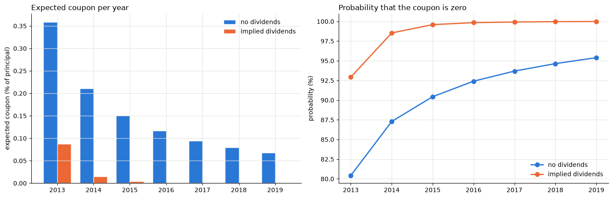
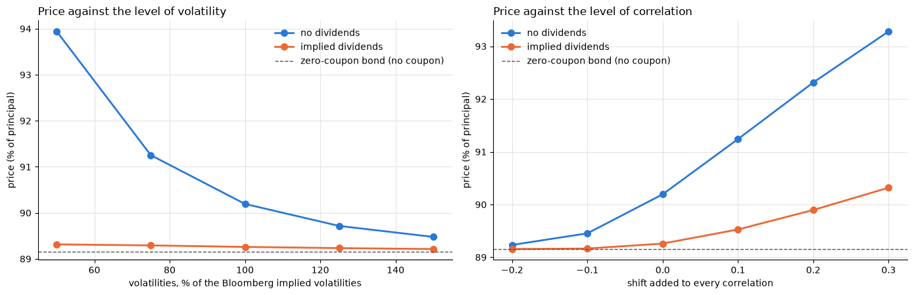
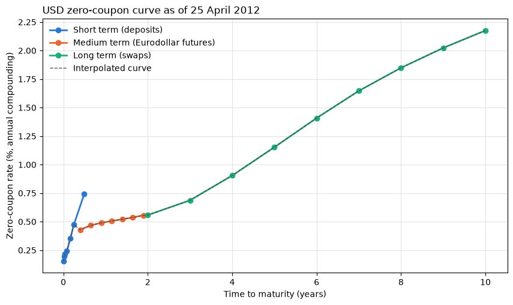
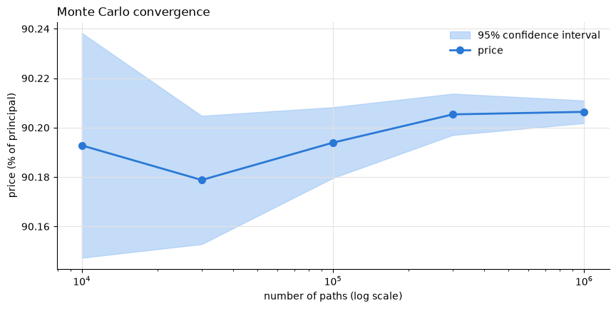

# HSBC 7-year Annual Income Opportunity CD: pricing a structured basket product

Pricing and risk of a principal-protected certificate of deposit issued by HSBC Bank USA on 25 April 2012. It returns 100% of the principal after seven years and pays each year a coupon based on a basket of US stocks: each stock counts for at most +6.25% and at least -30% and the coupon is the basket average floored at 0%.

The notebook bootstraps a USD zero-coupon curve from deposits Eurodollar futures and swaps simulates the nine correlated stocks under Black-Scholes and prices the CD with its risks to the stocks the volatilities the correlations and the rates.

## Results

| | No dividends | Dividends implied by the Bloomberg forwards |
|---|---:|---:|
| **Fair value** (% of principal) | **90.21** | **89.26** |
| Zero-coupon bond (principal) | 89.16 | 89.16 |
| Seven coupons | 1.05 | 0.11 |
| Issue price minus fair value | 9.79 | 10.74 |
| Correlation +10% / -10% | +1.05 / -0.75 | +0.27 / -0.10 |
| Rates +10 bp / -10 bp | -0.58 / +0.58 | -0.61 / +0.61 |

300 000 paths with a standard error 0.004 (no dividends) and 0.001 (dividends). Market data of 25 April 2012 from Bloomberg.

## Key findings

**1. The CD is a zero-coupon bond sold at 100:** The discounted principal is worth 89.16 and the seven coupons together are worth 1.05 points without dividends and 0.11 points with the dividends the market expects. The investor pays 9.8 to 10.7 points more than the value of what he receives.

**2. The coupon is zero almost every year:** Without dividends it is zero in 80% of the paths in 2013 and 95% in 2019. With dividends the probability goes from 93% to over 99.9%. The maximum coupon of 6.25% needs all nine stocks above their initial price which happens in about 0.1% of the paths or less.



**3. Why? a capped upside and a deep downside averaged:** Each stock adds at most +6.25% but can subtract down to 30%. As the nine stocks drift apart over the years a few losers are enough to pull the average below zero. That is why the expected coupon falls every year from 0.36% in 2013 to 0.07% in 2019 without dividends.

**4. The CD is short volatility long correlation and mostly a rate product:** More volatility means more dispersion and lower coupons. More correlation means the stocks move together and the average is more often positive. Once dividends are included the coupons are so far out of the money that these risks almost vanish and the CD is driven by rates: about -0.6 points per +10 bp the sensitivity of a 7-year zero-coupon bond.



## The product

| Term | Value |
|---|---|
| Issuer | HSBC Bank USA N.A. FDIC-insured CD |
| Trade date (Initial Fixing Date) / settlement | 25 April 2012 / 30 April 2012 |
| Maturity | 30 April 2019 100% of the principal |
| Interest valuation dates | 25 April 2013 25 April 2014 27 April 2015 27 April 2016 26 April 2017 25 April 2018 25 April 2019 |
| Interest payment dates | 30 April 2013 30 April 2014 30 April 2015 2 May 2016 1 May 2017 30 April 2018 30 April 2019 |
| Auto Cap Rate / Floor Rate | 6.25% / -30% per stock |
| Reference securities | AEP T BIIB KMB LMT MXIM PFE RL MOS |

The term sheet has a tenth stock Silver Wheaton which is not in the Bloomberg data set. the basket is priced on the nine others.

For each stock $i$ and valuation date $t$:

$$
R_i(t) = \begin{cases}
6.25\% & \text{si } S_i(t) \ge S_i(0) \\
\max\left(\frac{S_i(t)}{S_i(0)} - 1, -30\%\right) & \text{sinon}
\end{cases}
$$

$$
C(t) = 100 \times \max\left(\frac{1}{9} \sum_{i=1}^{9} R_i(t), 0\right)
$$

$$
P = \sum_{k=1}^{7} DF(t_k) \, \mathbb{E}[C(t_k)] + 100 \cdot DF(t_7)
$$

## Model

* **Rates:** USD zero-coupon curve with annual compounding deposits up to the first Eurodollar futures date (18 June 2012) the futures strip chained from one futures date to the next then the 2- to 10-year par swaps bootstrapped year after year. The curve reprices every swap at par. Discount factors are taken back to the settlement date on which the CD is paid for.



* **Stocks:** Correlated geometric Brownian motions from the trade date to each valuation date (ACT/365) with the Bloomberg implied volatilities and correlation matrix. The matrix is slightly not positive definite (smallest eigenvalue -0.0008) so the nearest positive definite covariance is used and its Cholesky factor is normalised so that each stock keeps exactly its own volatility. The drift is the 7-year Treasury rate 1.3624% minus the dividend yield.
* **Dividends:** The coupons use price returns without dividends. The dividend yields implied by the Bloomberg forwards to 30 April 2019 range from 0% (Biogen) to 11% (AT&T) and the notebook prices the CD with and without them.
* **Risks:** Bump and revaluation with the same random numbers and the same number of paths as the base price: each stock ±1% (initial share prices fixed) each volatility ±1 point all correlations ±10% (made positive definite again) and a parallel ±10 bp shift of the rates.



## Repository

```
notebooks/Pricing_a_Structured_Basket_Product.ipynb   inputs curve pricer risks validation and analysis (executed)
tests/                                                tests run on the functions of the notebook itself
docs/figures/                                         figures of this page exported from the notebook
```

```bash
pip install -r requirements.txt
pytest -q -m "not slow"                             # 10 tests on the notebook's functions a few seconds
python -m ipykernel install --user --name python3
pytest -q -m slow                                   # executes the whole notebook (about 2 minutes)
```

The tests check that the curve reprices the swaps at par and chains the futures that the simulation is risk-neutral with the input volatilities and correlations the coupon formula on known prices the closed form of the zero-volatility limit the reproducibility of every result and the signs of the risks. The notebook is seeded and gives identical outputs from one run to the next.

## Sources

* Term sheet: HSBC Bank USA *Annual Income Opportunity CDs Industry Titans* 7-year CD of 25 April 2012 (CUSIP 40431GP94) as used in the course *Exotic Options and Structured Products* Université Paris Dauphine. The course material is not included.
* Market data: Bloomberg screens of 25 April 2012 (spots implied volatilities correlation matrix forwards deposit rates Eurodollar futures swap rates) transcribed in the notebook. The screens are not included.
